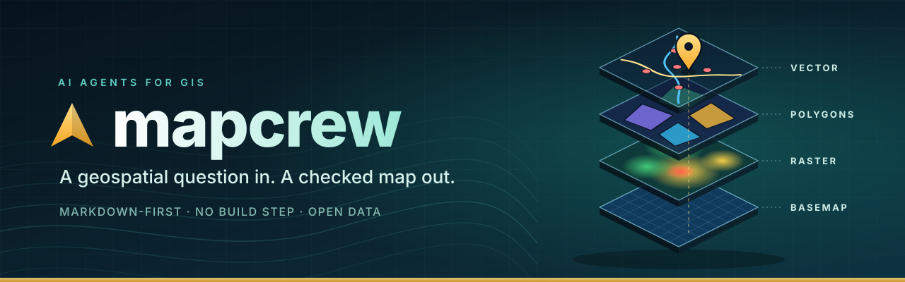

  

# MapCrew

MapCrew is a small, staged workflow for turning a geospatial question into a documented, quality-checked analysis and a shareable map. A lead agent, Captain, plans the route, hands work to specialist agents, and checks each handoff.

## Repository Layout

- `agents/` - Captain (orchestrator) plus Scout, Sentinel, Analyst, Cartographer, Web Builder, and Reviewer persona definitions.
- `workflows/` - reusable orchestration guides for quick maps and site selection.
- `templates/` - starter files for project briefs, QA reports, and map specifications.
- `viewer/` - a no-build Leaflet viewer starter that can be opened as a local HTML file.
- `examples/` - a documented open-data example using Natural Earth country boundaries.

## The Crew

| Agent | Responsibility |
|---|---|
| **Captain** | Clarifies the goal, chooses the route, manages handoffs and checkpoints, reports to you |
| **Scout** | Finds and documents candidate datasets |
| **Sentinel** | Checks data quality |
| **Analyst** | Documents the method and runs the analysis |
| **Cartographer** | Designs the map and prepares viewer-ready layers |
| **Web Builder** | Builds the interactive viewer |
| **Reviewer** | Checks reproducibility, licensing, and gives the final go/no-go |

Captain is the first agent you talk to and the last one you hear from. Captain does not do the specialist work.

## Typical Sequence

1. Start with Captain (`agents/captain.md`). Captain clarifies your question and constraints using `templates/brief-template.md` and saves the result as `project-brief.md`.
2. Captain picks a route, such as `workflows/quick-map.md` or `workflows/site-selection.md`, and records it in `flight-plan.md`. Progress is tracked in `project-state.md` so work can be resumed later.
3. Scout documents candidate sources in `data-sources.md`; verify license, attribution, and coverage before selection.
4. Sentinel checks data quality and records results in `qa-report.md`.
5. Analyst documents the method and CRS in `analysis-plan.md`, then saves and runs the analysis script.
6. Cartographer documents the map in `map-spec.md` and prepares viewer-ready layers.
7. Web Builder creates `viewer.html`.
8. Reviewer records a final go/no-go in `review.md`.
9. Captain delivers the final outputs and a short project summary.

Captain may skip steps that are not needed (for example, Scout when you already have data) and records the reason in `flight-plan.md`.

Do not skip a failed QA gate or present assumptions as verified facts. Keep source data unchanged; save derived outputs separately and document transformations.

## Checkpoints

Captain pauses to confirm with you after the brief, after data QA, after the analysis, and after the final review. If something unexpected comes up between checkpoints, such as unusable data, implausible results, or a change of scope, Captain stops and asks before continuing.

## Viewer Starter

Open `viewer/viewer.html` directly in a modern browser and choose one or more GeoJSON files. The starter needs no build step or API key. Leaflet and OpenStreetMap tiles are loaded from public internet services, so an internet connection is required for the map library and basemap. OpenStreetMap attribution is included; respect the tile service usage policy and use an appropriate provider for production or high-volume use.

## Example

See [`examples/natural-earth-continents/`](examples/natural-earth-continents/) for source notes and a map specification for a categorical continent map. The dataset is not bundled; follow the source instructions there and inspect the downloaded archive metadata before use.
